# Service backend flow

This doc describes how AutoDarkModeSvc decides on a theme and applies it. It starts with one overview diagram and then goes one level deeper per topic: modules and timers, governors, the time switch, the `RequestSwitch` decision chain, switch components, postpones, and the battery and energy saver overrides. The last two sections list the files that branch on the governor type and sketch a way to move those branches into the governor classes.

Everything here comes from reading the code on master at commit 031cc479. Line numbers drift, so the doc names classes and methods and leaves out line references.

## Level 0: overview

Every theme change in the service ends in `ThemeManager.UpdateTheme`. Most callers reach it through `ThemeManager.RequestSwitch`, which decides which theme wins. A few callers call `UpdateTheme` directly and skip that decision.

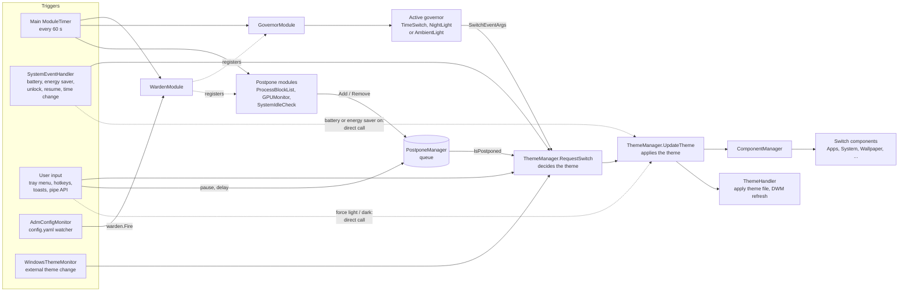

The dotted lines into `UpdateTheme` are the bypass paths. The battery and energy saver handlers are two of them, and the battery section below shows what that changes.

`RequestSwitch` reads three GlobalState fields to decide. GlobalState.InternalTheme is the theme the service last applied (or is applying). "Force light" and "force dark" set GlobalState.ForcedTheme. The NightLight and AmbientLight governors write the theme they last computed to GlobalState.NightLight.Requested and GlobalState.AmbientLight.Requested.

## Level 1: modules and timers

The Service constructor creates three ModuleTimer instances and registers one module, the WardenModule, on the main timer. Warden registers and deregisters every other module from the current config each time it fires.

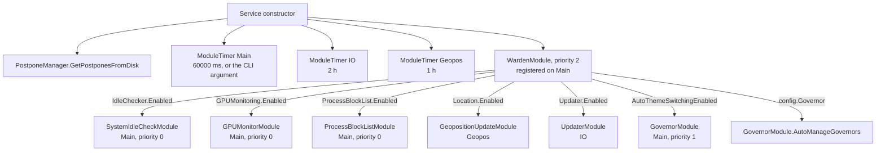

On every tick, ModuleTimer copies its module list and calls `Fire` on each module in priority order, highest first. On the main timer that order is Warden (2), GovernorModule (1), then the priority 0 modules. The order matters: GovernorModule sets the "switch approaching" flag before the dependency modules read it in the same tick.

| Module | Timer | What it does | Touches the postpone queue |
| --- | --- | --- | --- |
| WardenModule | Main | Registers the other modules from config, picks the governor | No |
| GovernorModule | Main | Runs the active governor and sends its SwitchEventArgs to `RequestSwitch` | No |
| SystemIdleCheckModule | Main | Reads `GetLastInputInfo` and compares it to IdleChecker.Threshold | Adds SystemIdleCheckModule while the user is active, removes it when idle |
| ProcessBlockListModule | Main | Looks for a running process with a main window from ProcessBlockList.ProcessNames | Adds ProcessBlockListModule while one runs |
| GPUMonitorModule | Main | Samples the "GPU Engine" performance counters | Adds GPUMonitorModule when a switch approaches, removes it after GPUMonitoring.Samples samples under the threshold |
| GeopositionUpdateModule | Geopos | Calls `LocationHandler.UpdateGeoposition` after the polling cooldown | No |
| UpdaterModule | IO | Checks for updates | No |

The three postpone modules differ in when they act. ProcessBlockListModule and GPUMonitorModule are dependency modules: their `EnableHook` calls `GlobalState.SwitchApproach.AddDependency`, and they only act around a switch. GPUMonitorModule starts sampling when GovernorModule sets ThemeSwitchApproaching. ProcessBlockListModule checks processes during that window, and keeps checking while its own postpone is still in the queue. Governors report a switch window only when SwitchApproach.DependenciesPresent is true, so without a dependency module registered there is no window at all. The governor section below shows the window sequence.

SystemIdleCheckModule never registers with SwitchApproach and ignores the window. It runs on every main tick and keeps its postpone in the queue whenever the user is active, so it blocks switches at any time of day.

Modules receive config updates through `AdmConfigMonitor.PerformConfigUpdate`. It reloads config.yaml, pushes new settings into every switch component, re-registers the battery and energy saver events, runs the ConfigUpdateEvent handlers, fires Warden, and recalculates when a PauseAutoSwitch postpone expires.

## Level 1: governors

A governor answers "which theme should be active now". `GovernorModule.AutoManageGovernors` creates one governor from config.Governor and stores it in GovernorModule.ActiveGovernor. GovernorModule calls that governor's `Run` method on every main tick. `Run` returns a GovernorEventArgs with three fields:

| Field | Meaning |
| --- | --- |
| InSwitchWindow | A switch is about to happen; give the dependency modules a chance to postpone it |
| InstantSwitchWindow | The window has zero length, so GovernorModule runs the dependency modules itself before requesting the switch |
| SwitchEventArgs | The switch request, or null for "nothing to request" |

| Governor | Input | Theme in its request | Switch window |
| --- | --- | --- | --- |
| TimeSwitchGovernor | config Sunrise and Sunset, or `LocationHandler.GetSunTimes` when Location.Enabled, plus offsets | Theme.Resolve, always | The tick that lands in the 60 s before the switch time |
| NightLightGovernor | WMI watcher on the bluelightreductionstate registry value | state.NightLight.Requested (Light or Dark), with the offset-adjusted switch time | After the night light change: the tick that lands in the 60 s before change time + offset; instant when the offset is 0 |
| AmbientLightGovernor | Windows.Devices.Sensors.LightSensor readings, or webcam and weather samples (Open-Meteo or Bing Weather) on a timer, DarkThreshold and LightThreshold with hysteresis, debounce of at least 1000 ms | state.AmbientLight.Requested (Light or Dark) | Always instant, on the fire the governor caused itself |

TimeSwitchGovernor is stateless and sends Theme.Resolve, so ThemeManager computes the theme. The other two compute the theme themselves, store it in GlobalState, and call `GovernorModule.Fire` from their own event handlers when it changes. Whether a request carries Theme.Resolve or a concrete theme decides which checks in `RequestSwitch` run on it (see the `RequestSwitch` section).

### Switch window

The switch window gives the dependency modules (GPUMonitorModule and ProcessBlockListModule, see the modules section) a chance to add a postpone before GovernorModule calls `RequestSwitch`. Governors only report a window when at least one dependency module is registered. On each fire, GovernorModule does one of three things with what `Run` returned:

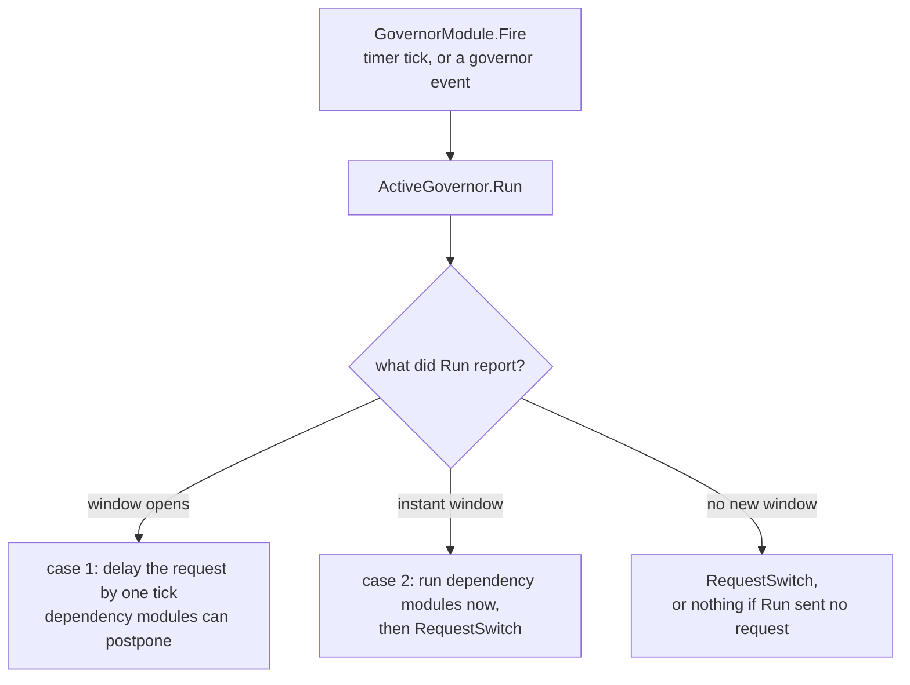

When a window opens, GovernorModule sets GlobalState.SwitchApproach.ThemeSwitchApproaching, which GPUMonitorModule and ProcessBlockListModule read later in the same tick. GovernorModule clears the flag on the first fire where `Run` no longer reports a window. It only delays the request on the fire that opens the window, so a second fire inside the same window sends the request straight away.

### Case 1: window with a predictable switch time

Only TimeSwitchGovernor knows the switch time in advance, because it computes sunrise and sunset itself. It reports the window on the tick that lands in the 60 s before the switch time, the dependency modules check their condition during that tick, and the request on the following tick finds their postpone in the queue. The timeline in the time switch section shows these ranges.

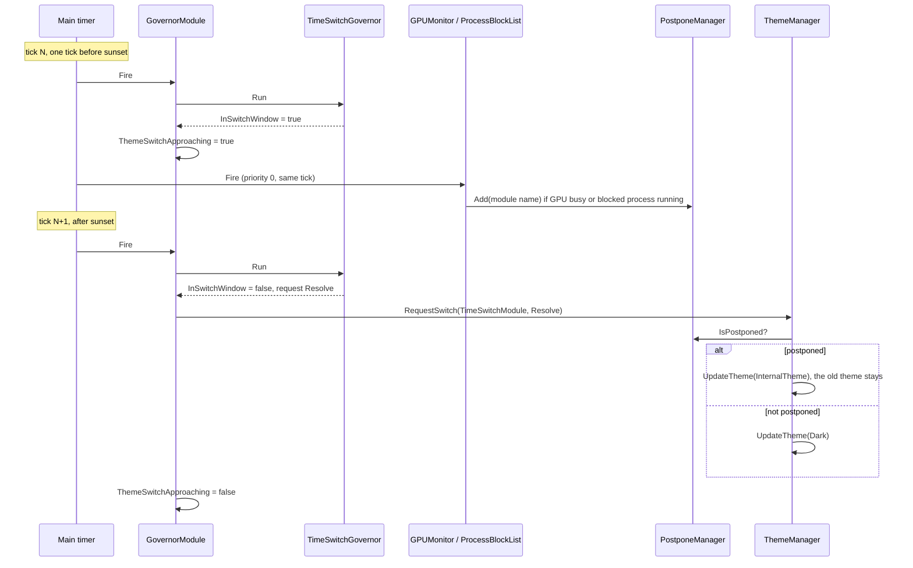

NightLightGovernor with an offset above 0 also goes through case 1, but it cannot see the night light change coming. When Windows flips the bluelightreductionstate value at time T, `NightLightGovernor.UpdateNightLightState` sets the governor's switch time A to T plus SunsetOffsetMin or SunriseOffsetMin, and `Run` keeps sending the old theme until A. The tick that lands in the 60 s before A opens the window, and the first tick after A sends the new theme. The switch therefore lands after the night light change, delayed by the offset. With a one minute offset, the window opens on the fire the change caused. In night light mode the app sets the offset minimum to 0 (OffsetTimesMinimum in AutoSwitchViewModel), so the governor never has to report a window before T.

```mermaid
gantt
    title Night light turns on at T = 21:00, offset 5 min, main tick every 60 s
    dateFormat HH:mm:ss
    axisFormat %H:%M:%S
    tickInterval 1minute
    section Ranges
    Run sends the old theme, T to A         :done, 21:00:00, 300s
    Dependency window, A minus 60 s to A    :active, 21:04:00, 60s
    section Events
    T, night light turns on                 :milestone, 21:00:00, 0s
    A, T plus offset                        :milestone, 21:05:00, 0s
    section Fires
    fire caused by the registry change      :milestone, 21:00:00, 0s
    tick, old theme, no-op                  :milestone, 21:03:20, 0s
    tick, window opens                      :milestone, 21:04:20, 0s
    tick, new theme requested               :milestone, 21:05:20, 0s
```

### Case 2: instant switch window

NightLightGovernor with offset 0 and AmbientLightGovernor cannot know the switch time ahead. They set a one-shot "pending" flag and call `GovernorModule.Fire` from their event handler. `Run` consumes the flag and reports an instant window, so GovernorModule awaits each dependency module before it sends the request.

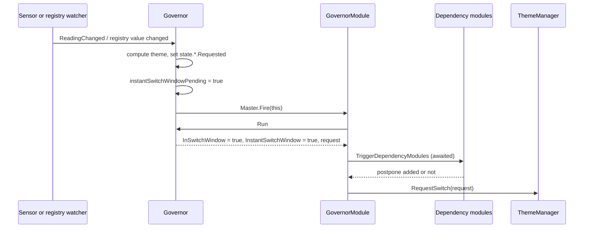

## Level 2: the time switch end to end

The time switch reconciles the theme on every tick. Each main tick sends a Theme.Resolve request; `UpdateTheme` compares each component against the target and does nothing when everything already matches. The first tick at or after sunset finds a target that differs from the applied theme, and that tick switches the theme. Ticks are not aligned to the switch time, so the switch lands 0 to 60 s after sunset.

### Tick ranges around a switch

TimeSwitchGovernor checks two time ranges around each switch time S. The example uses sunset at 18:00 and the default main tick period of 60 s (TimerFrequency.Main). The ticks land at 20 s past each minute.

| Range | From | To | Checked when | Effect |
| --- | --- | --- | --- | --- |
| Dependency window | S minus 60 s | S | DependenciesPresent | `Run` reports InSwitchWindow, GovernorModule delays the request by one tick |
| Notify range | S | S plus 120 s | AutoSwitchNotify.Enabled, no SessionLock and no SwitchNotification postpone | `Run` shows the toast, adds a SwitchNotification postpone and sends no request |

```mermaid
gantt
    title Time switch around sunset S = 18:00, main tick every 60 s
    dateFormat HH:mm:ss
    axisFormat %H:%M:%S
    tickInterval 1minute
    section Ranges
    Dependency window, S minus 60 s to S    :active, 17:59:00, 60s
    Notify range, S to S plus 120 s         :crit, 18:00:00, 120s
    section Switch time
    S, sunset                               :milestone, 18:00:00, 0s
    section Main ticks
    tick A                                  :milestone, 17:58:20, 0s
    tick B                                  :milestone, 17:59:20, 0s
    tick C                                  :milestone, 18:00:20, 0s
    tick D                                  :milestone, 18:01:20, 0s
    tick E                                  :milestone, 18:02:20, 0s
```

The table assumes GPUMonitorModule or ProcessBlockListModule is enabled. Without one, tick B sends an ordinary Resolve request, which changes nothing because the target is still light.

| Tick | Range | AutoSwitchNotify off | AutoSwitchNotify on |
| --- | --- | --- | --- |
| A, 17:58:20 | none | Resolve request, target is light, no-op | Same |
| B, 17:59:20 | dependency window | Window opens: ThemeSwitchApproaching = true, no request. GPUMonitorModule and ProcessBlockListModule run and may add their postpone | Same |
| C, 18:00:20 | notify range | Resolve request: switches to dark, or keeps light if a dependency postpone is queued. ThemeSwitchApproaching cleared | Toast shown, SwitchNotification postpone added, no request. ThemeSwitchApproaching stays set |
| D, 18:01:20 | notify range | Resolve request: no-op if C switched, otherwise switches once the dependency postpone is gone | SwitchNotification postpone exists, so no toast. Resolve request finds the postpone, light stays. ThemeSwitchApproaching cleared |
| E and later | none | Same as D | Resolve request on every tick. The first tick after the SwitchNotification postpone expires (GracePeriodMinutes) and the dependency postpones are gone switches to dark |

When a PauseAutoSwitch or DelayAutoSwitch postpone exists, `ToastHandler.InvokeDelayAutoSwitchNotifyToast` returns without a toast, but `Run` still reports a window without a request for the ticks in the notify range. Those ticks send nothing, and the user's postpone blocks the switch on the ticks after.

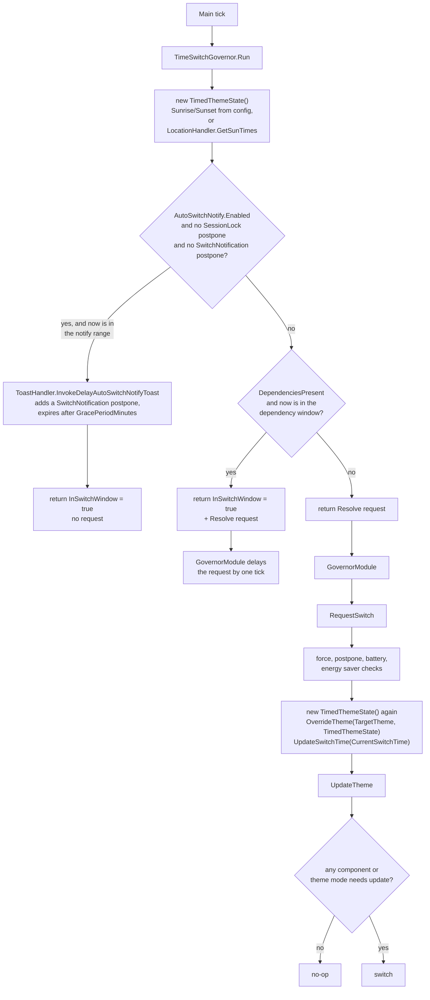

TimeSwitchGovernor computes TimedThemeState, uses it only for the window check, and sends Resolve. ThemeManager then builds a second TimedThemeState to get the actual theme. The other two governors put the theme in their request.

## Level 2: `RequestSwitch` decision chain

`RequestSwitch` is a chain of early returns. The order of the checks is the precedence: whatever returns first wins. Each exit tags the request with a ThemeOverrideSource.

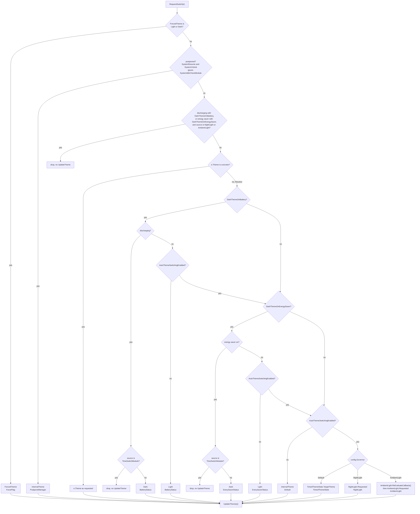

Requests with a concrete theme come from the NightLight and AmbientLight governors, manual toggles (`SwitchThemeAutoPause` and `SwitchThemeAutoPauseAndNotify`), and WindowsThemeMonitor (which sends InternalTheme). Everything else sends Resolve: the TimeSwitch governor, "request switch" from the app and toasts, resume and unlock, startup, time zone changes, and battery or energy saver turning off.

A concrete request skips the battery, energy saver and governor checks. The B0 check exists to stop the NightLight and AmbientLight governors from overriding the battery rule. It checks only those two sources.

### Manual toggle and the postpone it creates

`SwitchThemeAutoPause` (pipe API "swap", tray toggle, hotkey toggle) flips the theme and adds a postpone so the active governor does not switch straight back. Each governor gets a different postpone, and `ThemeManager.PrepareSwitchAutoPause` contains all three versions.

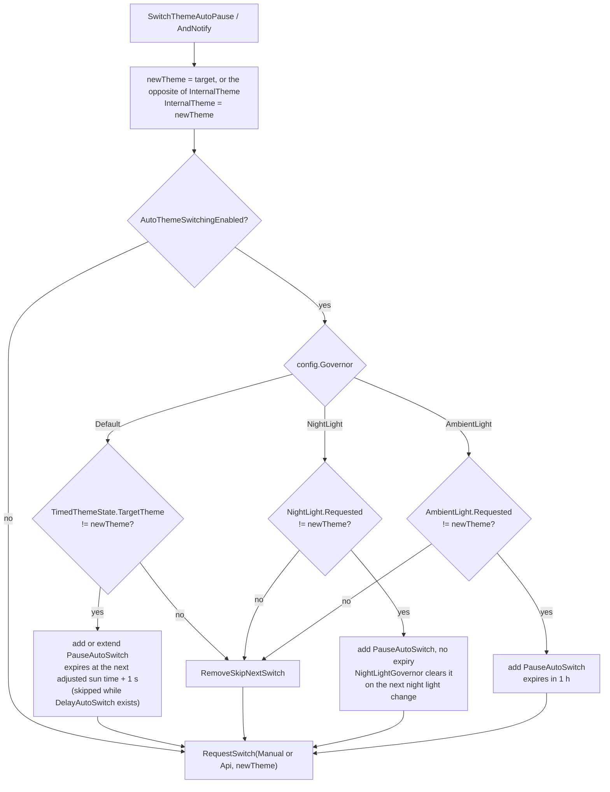

When the toggle goes against the governor, `RequestSwitch` finds the new PauseAutoSwitch item and leaves through the postpone exit with InternalTheme, which `PrepareSwitchAutoPause` already set to newTheme. The battery checks never see that request. When the toggle matches the governor, no pause is added and the request leaves through the concrete-theme exit.

## Level 2: switch components

`UpdateTheme` applies one theme. It asks ComponentManager which components are out of date, runs them in two groups around the theme file sync, applies the theme, and refreshes DWM if a component needs it.

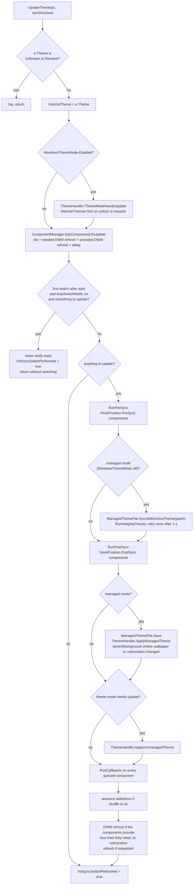

`GetComponentsToUpdate` puts a component in the list when one of these conditions is true:

1. It is enabled, and either WindowsThemeMode is off or the component has ThemeHandlerCompatibility, and its `ComponentNeedsUpdate` returns true. The component runs its `EnableHook` first if it is not initialized.
2. It is disabled but still initialized. `Switch` then runs its `DisableHook`.
3. Its ForceSwitch flag is set.

| Component | Config section | Works with WindowsThemeMode | Hook position | Priority (light / dark) | Needs DWM refresh |
| --- | --- | --- | --- | --- | --- |
| AppsSwitch | AppsSwitch | No | PostSync | 0 / 0 | Standard |
| SystemSwitch | SystemSwitch | No | PostSync | 0 / 0 | Standard |
| AccentColorSwitch | SystemSwitch | Yes | PostSync | 0 / 0 | Standard |
| TaskbarColorSwitch | SystemSwitch | Yes | PostSync | 0 / 0 | Standard |
| ColorFilterSwitch | ColorFilterSwitch | Yes | PostSync | 0 / 0 | None |
| WallpaperSwitch | WallpaperSwitch | No | PreSync or PostSync, depends on wallpaper type | 25 / 25 | None |
| ScriptSwitch | scripts.yaml | Yes | PostSync | 30 / 30 | None |
| TouchKeyboardSwitch | TouchKeyboardSwitch | Yes | PostSync | 0 / 0 | None |
| ColorizationSwitch | ColorizationSwitch | No | PostSync | 0 / 0 | None |
| CursorSwitch | CursorSwitch | No | PostSync | 0 / 0 | None |

A component in managed mode mostly edits GlobalState.ManagedThemeFile (AppsSwitch writes VisualStyles.AppMode, for example), and `ApplyManagedTheme` writes all edits to Windows in one apply. Components sort ascending by PriorityToLight or PriorityToDark, so ScriptSwitch runs last.

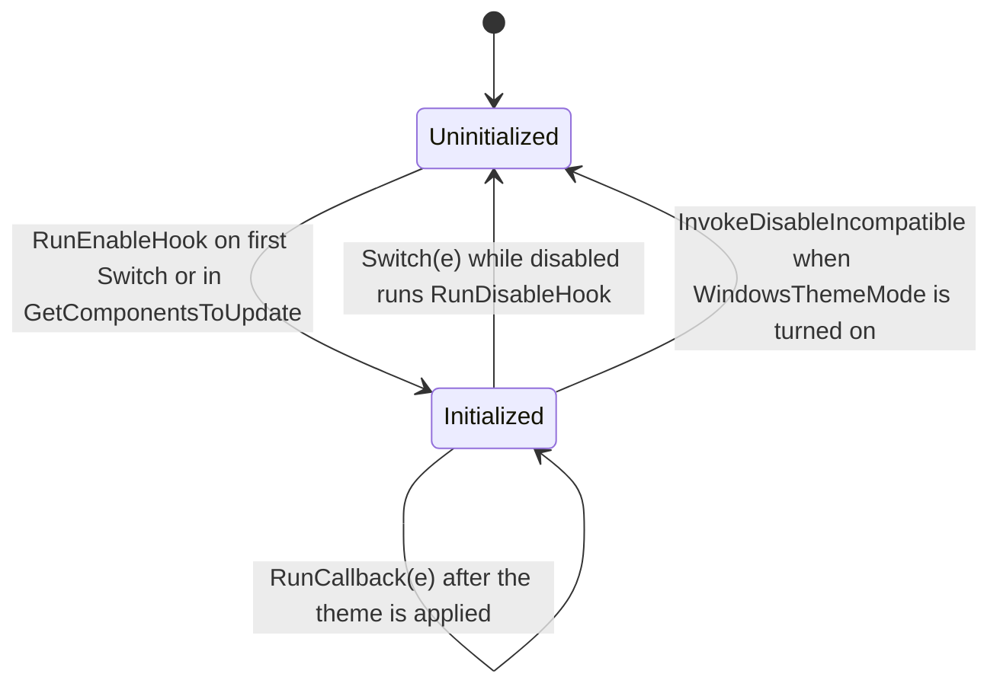

## Level 2: postpone system

PostponeManager stores PostponeItem objects in a list called PostponeQueue, one per reason string, and any item in the list makes IsPostponed true. A postpone freezes the choice between light and dark at GlobalState.InternalTheme. Switching itself keeps running: a request that reaches the postpone check in `RequestSwitch` still calls `UpdateTheme`, only with InternalTheme as the theme. `GetComponentsToUpdate` then compares every component against that theme as usual, so a settings change made while a postpone is queued is applied right away, in the postponed theme.

The postpone check is the second check in `RequestSwitch`. Only ForcedTheme comes before it, and three paths never reach it: the battery and energy saver handlers and "force light" or "force dark", which call `UpdateTheme` directly. A path that writes InternalTheme before it requests a switch moves the postponed theme.

### How other mechanisms behave while a postpone is queued

| Mechanism | Behavior while the queue is not empty |
| --- | --- |
| Governor ticks (all three governors) | The request leaves through the postpone exit, and `UpdateTheme` re-checks the components against InternalTheme. AmbientLightGovernor also stops evaluating lux readings, so state.AmbientLight.Requested stays where it was |
| Settings change in the app (wallpaper, colors, cursors, system areas, theme picker) | The app saves config.yaml and sends Command.RequestSwitch over the pipe. MessageParser waits on ConfigIsUpdatingWaitHandle until AdmConfigMonitor has loaded the file, then calls `RequestSwitch` with SwitchSource.Manual. The postpone exit applies the new settings for InternalTheme. With light postponed past sunset, a new light wallpaper shows at once; a new dark wallpaper is stored and shows once the switch to dark happens |
| Manual toggle (tray, hotkey, pipe API swap) | `PrepareSwitchAutoPause` writes the new theme to InternalTheme before it calls `RequestSwitch`, so the postpone exit applies the toggled theme. The postpones stay queued and keep the toggled theme from then on |
| Force light or dark | ForcedTheme is checked before the postpone, so the forced theme wins. The postpones stay queued and apply again once the force is cleared |
| Battery starts discharging, energy saver turns on | `UpdateTheme(Dark)` is called directly and ignores the queue. InternalTheme becomes dark, so later postponed requests keep dark |
| Battery charging again, energy saver turns off | The Resolve request leaves through the postpone exit and dark stays (behavior 2 in the battery section) |
| Unlock and resume | SystemEventHandler sends no request while a PauseAutoSwitch or DelayAutoSwitch postpone exists. Otherwise the request skips only the SystemIdleCheckModule postpone, and any other postpone keeps InternalTheme |
| Tray "try fix theme" | Postpone exit with a DWM refresh through colorization, for InternalTheme |
| WindowsThemeMonitor | Sends InternalTheme anyway, so the postpone changes nothing |
| Service restart | `FlushPostponesToDisk` saves InternalTheme as InternalThemeAtExit together with PauseAutoSwitch and DelayAutoSwitch items. `GetPostponesFromDisk` restores both, so the postponed theme survives the restart |

### Postpone reasons

| Reason | Added by | Removed by | User clearable | Expiry | Kept across restarts |
| --- | --- | --- | --- | --- | --- |
| PauseAutoSwitch | `AddSkipNextSwitch` (tray "pause", hotkey, toast) and `PrepareSwitchAutoPause` | Expiry, `RemoveSkipNextSwitch`, NightLightGovernor | Yes | TimeSwitch: next adjusted sun time + 1 s. NightLight: none. AmbientLight: 1 h | Yes |
| DelayAutoSwitch | Toast choice 15, 30, 60 or 180 min, pipe API DelayBy | Expiry | Yes | The chosen minutes | Yes |
| SwitchNotification | `ToastHandler.InvokeDelayAutoSwitchNotifyToast` | Expiry, toast "switch now" or a delay choice | Yes | AutoSwitchNotify.GracePeriodMinutes | No |
| SessionLock | Session lock event | Unlock event | Yes | None | No |
| SystemIdleCheckModule | SystemIdleCheckModule while the user is active | Same module once idle longer than the threshold | No | None | No |
| ProcessBlockListModule | ProcessBlockListModule while a listed process runs | Same module | Yes | None | No |
| GPUMonitorModule | GPUMonitorModule when a switch approaches | Same module after enough quiet samples | Yes | None | No |

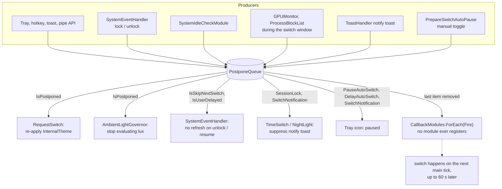

Each item with an expiry time starts a `Task.Delay` and removes itself from the queue when the delay finishes. After a resume or a system clock change, `SyncExpiryTimesWithSystemClock` restarts the timers of PauseAutoSwitch and DelayAutoSwitch items. On exit, `FlushPostponesToDisk` writes only user-clearable PauseAutoSwitch and DelayAutoSwitch items plus InternalTheme; on start, `GetPostponesFromDisk` drops a night light pause that is older than a day or that no longer matches the night light state.

Nothing calls `PostponeManager.RegisterCallbackModule`, so the "queue cleared" callback in `Remove` fires on an empty list. After the queue empties, the next main tick requests the switch the postpone held back. Three user paths call `RequestSwitch` themselves right after clearing: the tray "pause" toggle, the toast "switch now" button, and the TogglePostpone hotkey (after 2 s).

## Level 2: battery and energy saver overrides

The battery and energy saver options act in two places. SystemEventHandler subscribes to the Windows power events and requests a switch when the power state changes. `RequestSwitch` checks the same options again on every Resolve request that arrives while the battery discharges or energy saver is on.

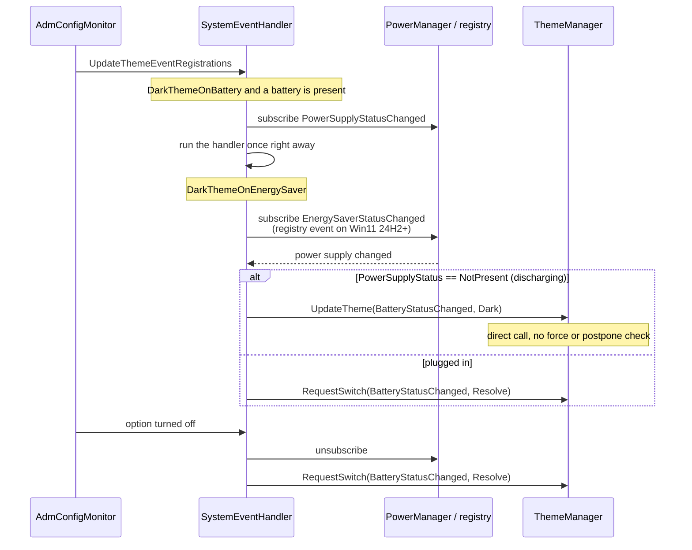

While discharging with DarkThemeOnBattery on, each source ends up like this:

| Request | Theme in request | Result |
| --- | --- | --- |
| TimeSwitchGovernor tick | Resolve | Dropped (BAT2), dark stays |
| NightLight or AmbientLight governor | concrete | Dropped (B0), dark stays |
| Force light or dark | direct `UpdateTheme`, then ForceFlag on later requests | Forced theme wins |
| Manual toggle, pipe API swap | concrete, plus a PauseAutoSwitch postpone | Toggled theme wins |
| App "request switch", toast "switch now", unlock, resume, startup | Resolve | Dark |
| Any request while the postpone queue is not empty | either | InternalTheme |

### Stuff that's a bit wonky and we need to work out by properly modularizing all of the event overrides

1. The unplug and energy-saver-on handlers call `UpdateTheme` directly, so they ignore ForcedTheme. With "force light" active, unplugging switches to dark, and the next main tick sends a TimeSwitch request that hits the ForceFlag check and switches back to light.
2. Plugging in sends a Resolve request through `RequestSwitch`, and the postpone check comes before the battery check. With the idle checker on, SystemIdleCheckModule keeps a postpone in the queue whenever the user is active, so the theme stays dark after plugging in until the user goes idle.
3. With DarkThemeOnBattery on, auto switching off and the device on AC, the battery branch returns Light before the energy saver branch runs. A Resolve request then sets light even while energy saver is on.
4. The same branch returns Light for any Resolve request on AC while auto switching is off. The theme the user had before unplugging is not restored.
5. A request with SwitchSource.Manual can win or lose against the battery rule, depending on whether it carries a concrete theme or Resolve.

## Where the code branches on the governor type

Nine methods in six files outside the three governor classes compare config.Governor against Governor.Default, Governor.NightLight or Governor.AmbientLight, 19 comparisons in total. Each method uses the comparison to pick a per-governor answer to a question the active governor could answer itself, such as which theme it wants now or when a pause after a manual toggle expires. Adding a fourth governor means adding a branch to every one of these methods.

| File | Method | What it picks per governor |
| --- | --- | --- |
| Core/ThemeManager.cs | `RequestSwitch` | Target theme per governor (TimedThemeState, NightLight.Requested, AmbientLight.Requested) |
| Core/ThemeManager.cs | `PrepareSwitchAutoPause` | Pause policy after a manual toggle |
| Core/PostponeManager.cs | `AddSkipNextSwitch`, `GetSkipNextSwitchExpiryTime`, `UpdateSkipNextSwitchExpiry` | When a pause expires and what SkipType it shows |
| Handlers/SystemEventHandler.cs | `NotifyAtResume` | Target theme per governor, AmbientLight missing |
| Handlers/ToastHandler.cs | `InvokeDelayAutoSwitchNotifyToast` | AmbientLight has no notify toast |
| Service.cs | `UpdateContextMenu` | Pause label per governor |
| Modules/GovernorModule.cs | `AutoManageGovernors` | Which governor class to create |

`AmbientLightGovernor.Run` also calls `builder.Load()` on every tick, which re-reads config.yaml from disk. In the other direction, `RequestSwitch` calls `state.AmbientLight.ReEvaluateCallback()`, which can call `GovernorModule.Fire` and start a second `RequestSwitch` from inside the first.

## Streamlining option proposal

This is not finished or fixed yet, these are proposals that try to improve a couple of weirdnesses I introduced over the years that I was never really happy with.

These options keep the existing flow (timer, governor module, `RequestSwitch`, `UpdateTheme`, components) and move the governor and precedence decisions into fewer files. They can land one at a time.

### Step 1: let the governor answer for itself

Add the knowledge from the table above to IAutoDarkModeGovernor, and give ThemeManager a reference to the active governor (through GlobalState or GovernorModule).

```csharp
public interface IAutoDarkModeGovernor
{
    Governor Type { get; }
    GovernorEventArgs Run();
    void EnableHook();
    void DisableHook();

    // new
    (Theme Theme, DateTime? SwitchTime) CurrentTarget();
    PostponeItem CreateSkipItem(Theme manualTheme);   // null when no pause is needed
    string PauseLabel();
}
```

`RequestSwitch`, `PrepareSwitchAutoPause`, `AddSkipNextSwitch`, `NotifyAtResume` and `UpdateContextMenu` then call the active governor in place of their switch on config.Governor. TimeSwitchGovernor can return its concrete target in its request, so every governor request carries a concrete theme.

### Step 2: treat overrides as prioritized items in the postpone queue

PostponeManager already gives each postpone what an override needs: add and remove by reason, expiry timers, persistence across restarts, the IsUserClearable flag, the tray "paused" state, and the queue listing on the pipe API. The battery override has the same lifecycle as a postpone. It starts when the battery discharges, ends when it charges again, and must not survive a restart. So every override that `RequestSwitch` checks today becomes an item in the same queue, and two new fields on PostponeItem say what the item wants and how strong it is:

```csharp
public class PostponeItem
{
    public string Reason { get; }
    public int Priority { get; }        // new
    public Theme Theme { get; }         // new: Light or Dark = override, Unknown = keep the base theme
    public bool IgnoredOnWake { get; }  // new: replaces IsPostponedExcept(SystemIdleCheckModule)
    public bool IsUserClearable { get; }
    public DateTime? Expiry { get; }
    ...
}
```

`RequestSwitch` then resolves the queue. It sorts the items by priority, highest first, with a stable sort so equal priorities keep the order they were added in. The top item decides: an item with a theme applies that theme, and an item with Theme.Unknown keeps the base theme. With an empty queue, the active governor's target applies (step 1).

The base theme is a new GlobalState field: the last theme `RequestSwitch` applied while no override item (an item with a theme) was on top of the queue. A postpone then freezes what the governor or the user chose, and an override on top of it does not change what the postpone keeps. Today a postpone keeps InternalTheme, and the unplug handler writes dark into InternalTheme, so dark stays after plugging in.

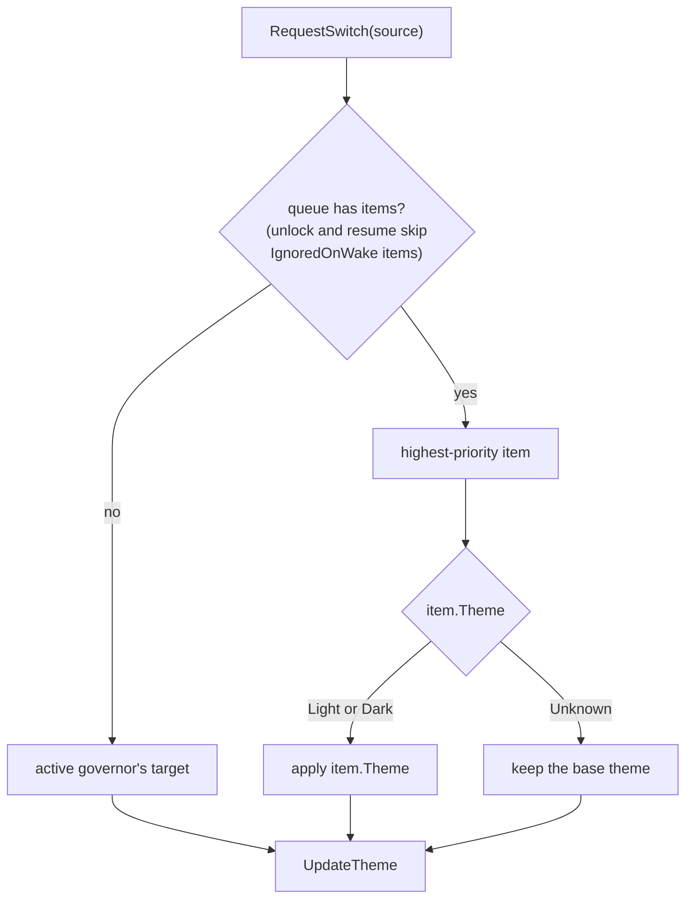

The event handlers stop deciding themselves. Each one adds or removes its item and calls `RequestSwitch` to resolve the queue again:

| Event | Queue change |
| --- | --- |
| Battery starts discharging (DarkThemeOnBattery on) | Add Battery item, Theme.Dark, not user clearable |
| Battery charging again | Remove Battery item |
| Energy saver on / off (DarkThemeOnEnergySaver on) | Add / remove EnergySaver item, Theme.Dark |
| Force light or force dark | Add Force item with that theme, until the deprecated force flags are removed |
| Manual toggle | Add PauseAutoSwitch with the toggled theme as Theme |
| Tray "pause", toast delay, pipe API DelayBy | Add PauseAutoSwitch or DelayAutoSwitch with Theme.Unknown |
| Dependency modules, idle checker, session lock, notify toast | Add their item with Theme.Unknown, as today |
| Any item removed or expired | Resolve the queue again right away |

Proposed default priorities:

| Priority | Items |
| --- | --- |
| 100 | Force |
| 80 | Battery, EnergySaver |
| 70 | PauseAutoSwitch, DelayAutoSwitch |
| 60 | SwitchNotification, SessionLock, SystemIdleCheckModule, ProcessBlockListModule, GPUMonitorModule |

The order between the items is a decision we make once in this table. Today the check order in `RequestSwitch` decides it by accident: unplugging ignores every postpone, plugging in loses to every postpone, and a manual toggle beats the battery rule only because it carries a concrete theme. Whether Battery should outrank a manual toggle, and whether it should break through a GPU or process block list postpone, are the two open questions.

#### What this changes

- The battery, energy saver and force handlers lose their direct `UpdateTheme` calls, so `UpdateTheme` has `RequestSwitch` as its single caller. Behaviors 1 and 2 in the battery section go away.
- The battery and energy saver checks, the governor power check for NightLight and AmbientLight, and the split between Theme.Resolve and concrete requests leave `RequestSwitch`. A request no longer needs to carry a theme.
- A postpone keeps the base theme, so a Battery item that comes and goes while a postpone is queued no longer leaves dark behind. A manual toggle also stores its theme in its PauseAutoSwitch item, so the toggled theme returns once the Battery item is removed.
- Removing an item resolves the queue at once. The unused CallbackModules list in PostponeManager goes away, and a switch held by a postpone no longer waits up to 60 s for the next tick.
- `FlushPostponesToDisk` already saves only PauseAutoSwitch and DelayAutoSwitch items, and "clear postpones" already leaves items with IsUserClearable = false alone, so Battery, EnergySaver and Force items are neither persisted nor cleared by the user.

#### What has to be split first

Today any item in the queue means "postponed", and these callers read it that way: AmbientLightGovernor stops evaluating lux, the tray icon shows paused, unlock and resume skip their refresh, the notify toast stays away, and the pipe API reports IsPostponed. With override items in the queue, being on battery would show "paused" in the tray and freeze the light sensor. So IsPostponed has to count only items with Theme.Unknown, override items get their own query (for example `ActiveOverride`), and each current IsPostponed caller has to be checked against that split.

### Step 3: keep config loading out of the governors

Drop `builder.Load()` from `AmbientLightGovernor.Run` and the `ReEvaluateCallback` call from `RequestSwitch`. AdmConfigMonitor already reloads the config on file change; the governor can re-evaluate its thresholds from a config update event.

### Step 4: sort the component list on every run

`RunPreSync`, `RunPostSync`, `RunCallbacks` and `RunIntegrityChecks` sort the list they get only when the new theme differs from ComponentManager.lastSorting. `GetComponentsToUpdate` builds a new, unsorted list on every `UpdateTheme`, and ComponentManager is a singleton, so lastSorting survives from the previous switch. The first `UpdateTheme(Dark)` runs the components in priority order. A second `UpdateTheme(Dark)`, for example after a settings change in the app, finds lastSorting already at dark and runs them in the order of the Components list. ScriptSwitch (priority 30) then runs before TouchKeyboardSwitch, TaskbarColorSwitch, ColorizationSwitch and CursorSwitch, where it should run last. `List.Sort` is also unstable, so components with equal priority have no fixed order even when the sort runs.

Sort once, in `GetComponentsToUpdate`, with a stable sort, and remove lastSorting and the four sort blocks:

```csharp
return (shouldUpdate
            .OrderBy(c => e.Theme == Theme.Dark ? c.PriorityToDark : c.PriorityToLight)
            .ToList(),
        needsDwmRefresh, dwmRefreshType, dwmRefreshDelay);
```

`OrderBy` keeps the order of the Components list for equal priorities, so the registration order becomes the tie-breaker.

### Step 5: let each component name its config section

Adding a component today means editing ComponentManager in three places: a field, the Components list, and a line in `UpdateSettings` that passes its config section. AccentColorSwitch and TaskbarColorSwitch read the SystemSwitch section, and only `UpdateSettings` shows that.

Move the section choice into the component, so the component class says which config it reads:

```csharp
// ISwitchComponent / BaseComponent<T>
public abstract object SelectSettings(AdmConfigBuilder builder);

// AccentColorSwitch
public override object SelectSettings(AdmConfigBuilder builder) => builder.Config.SystemSwitch;

// ScriptSwitch
public override object SelectSettings(AdmConfigBuilder builder) => builder.ScriptConfig;

// ComponentManager
public void UpdateSettings() => Components.ForEach(c => c.RunUpdateSettingsState(c.SelectSettings(Builder)));
```

ComponentManager then needs only the Components list, and a new component is its class plus one line in that list. `UpdateScriptSettings` can stay as a filtered call for ScriptSwitch, so a change to scripts.yaml does not run `UpdateSettingsState` on every other component.

### Step 6: let components say what the theme apply needs

`UpdateTheme` checks `c is ColorizationSwitch` and `c is WallpaperSwitch` to decide whether `ApplyManagedTheme` gets the IgnoreBackground flag, and it reads ColorizationSwitch's LightAutoColorization and DarkAutoColorization settings to do so. Add a member to ISwitchComponent that each component answers for itself:

```csharp
// BaseComponent<T>, default for every component
public virtual bool NeedsBackgroundApply(Theme newTheme) => false;

// WallpaperSwitch
public override bool NeedsBackgroundApply(Theme newTheme) => true;

// ColorizationSwitch
public override bool NeedsBackgroundApply(Theme newTheme) =>
    newTheme == Theme.Light ? Settings.Component.LightAutoColorization : Settings.Component.DarkAutoColorization;

// ThemeManager.UpdateTheme
if (!componentsToUpdate.Any(c => c.NeedsBackgroundApply(newTheme)))
    flagList = new() { ThemeApplyFlags.IgnoreBackground };
```

The integrity retry loop in `UpdateTheme` (re-sync the theme file, verify, call `Switch` again) can move next to `RunIntegrityChecks` in ComponentManager. It needs the theme file sync, so ThemeManager passes `SyncWithActiveTheme` in as a callback.

ForceSwitch and `ComponentManager.ForceAll` stay as they are. They go away together with the deprecated force light and force dark flags.
